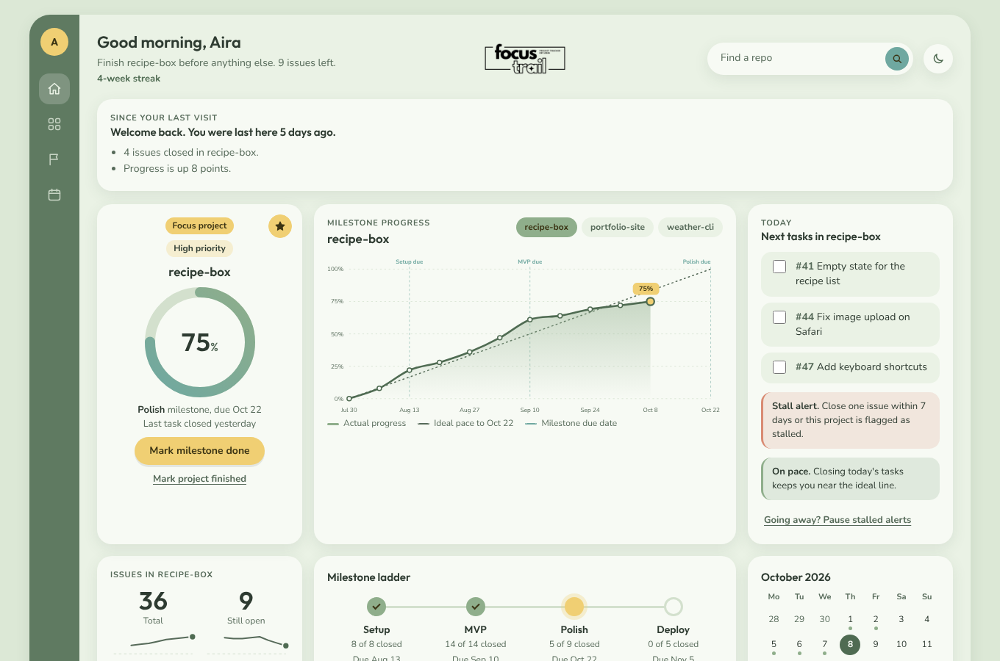

# Focus Trail

**One project at a time, until it ships.** Focus Trail is a personal dashboard that pulls your GitHub repos, graphs milestone progress for each one, and keeps you on a single Focus Project until it is deployed or finished. Switching focus means typing a reason, which is logged.

**[Try the live demo](https://focus-project-tracker.vercel.app/demo)** (example data, no sign-in, nothing is saved)



## What it does

- **One focus rule, enforced twice.** `setFocus` is the only code that changes focus, and a partial unique index in the database allows at most one `focus` project, so a bug cannot create two.
- **Progress from GitHub, not a second to-do list.** Percent complete is closed issues over total issues across a repo's milestones. Issues stay in GitHub; the app stores only what GitHub lacks.
- **History GitHub does not keep.** GitHub returns only current counts, so a daily snapshot job (Vercel Cron) and a first-run backfill from issue `closed_at` dates build the graphs, weekly streaks and the weekly review.
- **Alerts that respect real life.** Stalled (no issue closed in 7 days, configurable) and overdue (a milestone is past due) alerts, plus an Away mode that pauses them. Streaks count weeks, not days, and the dashboard shows what changed since your last visit.
- **Finishing is explicit.** Mark a project Finished or Deployed (with a checked live address), with an optional definition-of-done checklist and Vercel deploy status when the repo's homepage matches a Vercel project.
- **Single user, read-only on GitHub.** Sign-in is GitHub OAuth through Auth.js with an owner-only allow-list that fails closed; the token stays in the encrypted session cookie and is read only on the server.

## How it is built

| Area     | Choice                                                                                             |
| -------- | -------------------------------------------------------------------------------------------------- |
| App      | Next.js (App Router), React, TypeScript in strict mode, CSS modules with design tokens             |
| Data     | Turso (SQLite) with Drizzle and checked-in migrations                                              |
| GitHub   | Octokit behind a small data-access layer, so example data runs the whole UI with no network        |
| Auth     | Auth.js GitHub OAuth, owner-only                                                                   |
| Jobs     | Vercel Cron for daily snapshots and an optional reminder email (Resend)                            |
| Charts   | Hand-written SVG: line and area graphs, ideal-pace line, milestone due-date markers                |
| Quality  | Vitest unit tests for the core rules, axe-core accessibility pass in light and dark, 400 px layout |
| Workflow | Conventional Commits, Husky pre-commit `verify`, GitHub Actions CI, branch protection on `main`    |

The product rules live in [CLAUDE.md](CLAUDE.md), the plan in [PLANNING.md](PLANNING.md) and the task list in [TASKS.md](TASKS.md). The project was built by directing Claude Code through that written workflow: a rules file, a task list, hooks and CI as guardrails, and every change reviewed and merged through a pull request.

Docs: [PLANNING.md](PLANNING.md) (vision, architecture, stack) · [TASKS.md](TASKS.md) (milestones) · [CLAUDE.md](CLAUDE.md) (rules for Claude Code) · [mockup.html](mockup.html) (visual reference).

## Run it with example data

No accounts needed.

```bash
npm install
npm run dev
```

Open the URL it prints. `DATA_SOURCE=fixture` (the default) shows the example data from the mockup. `DATA_SOURCE=fixture-first-run` shows the same data with no focus project yet, so you can try picking one. `DATA_SOURCE=fixture-empty` shows an account with no repos, to check the empty states.

## Commit standards

Git hooks (Husky) run on every commit and block it when something fails.

- **Pre-commit:** formats and lints staged files, then `npm run verify`: dependency check, security audit, type check, lint (no warnings), unit tests, production build.
- **Commit message:** must follow [Conventional Commits](https://www.conventionalcommits.org), for example `feat(auth): add GitHub sign-in` or `fix(sync): keep status when a repo is renamed`. Subjects start lowercase, with no final period.
- **Audit exceptions:** a dev-tooling vulnerability with no available fix can be listed in `audit-allowlist.json` with a reason and review date. It expires and blocks commits again until re-checked. Production dependencies can never be listed.

Hooks are installed by `npm install` (the `prepare` script). Do not bypass them with `--no-verify`.

The same checks run on GitHub (`.github/workflows/ci.yml`) for every push to `main`, every pull request, and once a week for new security advisories.

## Scripts

| Command               | What it does                                         |
| --------------------- | ---------------------------------------------------- |
| `npm run dev`         | Start the dev server                                 |
| `npm run check`       | Quick check: type check, lint and unit tests         |
| `npm run verify`      | Everything the pre-commit hook runs (about a minute) |
| `npm run deps:check`  | Dependency tree, lockfile and npm warnings           |
| `npm run audit:check` | Security audit with the reviewed allow-list          |
| `npm run format`      | Format with Prettier                                 |
| `npm run db:generate` | Create a SQL migration after changing the schema     |
| `npm run db:migrate`  | Apply migrations to the database in `DATABASE_URL`   |

## Progress from TASKS.md

Focus Trail measures progress from GitHub milestones and issues. If a project keeps its plan in a `TASKS.md`, this tool turns it into milestones and issues:

```bash
npm run tasks:sync -- --repo crm --repo project-gantt-chart           # dry run: shows the plan, changes nothing
npm run tasks:sync -- --repo crm --apply                              # writes to GitHub
npm run tasks:sync -- --repo crm --apply --limit 3                    # create only 3 issues, to try it first
```

- It looks for `TASKS.md` in the top folder of the repo, then in `docs/`. If the task list is somewhere else, name it with `--file`, for example `--file planning/TASKS.md`. The file has to be pushed to GitHub, because the tool reads it from there, not from your computer.
- Every `## Milestone N ...` (or `## M<N> ...`) section becomes a milestone, and each `- [ ]` / `- [x]` task under it becomes an issue. Ticked tasks become closed issues, so progress is real from the start. The "Exit" or "Done when" line becomes the milestone description.
- Other sections (Ongoing, Backlog, "Before each commit") are skipped and listed, because their tasks never finish and would hold progress down.
- It is safe to run again: each issue carries a hidden key, so a second run only creates new tasks and closes issues whose task is now ticked. It never deletes, never reopens, and never edits an existing issue. If you rename a task in TASKS.md, a new issue is created and the old one is left alone.
- Repos are done in the order you list them. It uses the `gh` command line tool and whatever account it is signed in to.
- GitHub limits how fast issues can be created, so about 1,000 writes take 20 minutes. If it stops, run the same command again.
- Already-ticked tasks are closed at the moment of the run, so GitHub shows them as closed today. For a project with many ticked tasks, the "issues closed this week" chart and calendar spike on that day.

## Setup for real data

On a computer that does not have the project yet, start with [`docs/new-device-setup.md`](docs/new-device-setup.md).

Set `DATA_SOURCE=github` in `.env.local` after finishing the steps below, run `npm run db:migrate` once, then `npm run dev`. Star a project to mark it high priority; those projects are listed first. Visiting the app signs you in with GitHub, syncs your repos into the database, and records one progress snapshot per repo per day, so the graph history starts on your first visit.

Copy `.env.example` to `.env.local` and fill it in. Never commit `.env.local`.

### 1. GitHub OAuth App (sign-in)

1. GitHub, Settings, Developer settings, OAuth Apps, New OAuth App.
2. Homepage URL: `http://localhost:3000`.
3. Authorization callback URL: `http://localhost:3000/api/auth/callback/github`.
4. Create it, then generate a client secret.
5. Put the values in `.env.local`:
   - `GITHUB_CLIENT_ID` and `GITHUB_CLIENT_SECRET`
   - `ALLOWED_GITHUB_LOGIN`: your GitHub username. Nobody else can sign in.
   - `AUTH_SECRET`: run `openssl rand -base64 32`.
   - `AUTH_URL`: in Vercel set it to `https://focus-project-tracker.vercel.app` (not secret). Without it the callback uses whatever address you opened, and GitHub rejects it with "redirect_uri is not associated with this application".

The app also accepts Auth.js's own names, `AUTH_GITHUB_ID` and `AUTH_GITHUB_SECRET`, in place of `GITHUB_CLIENT_ID` and `GITHUB_CLIENT_SECRET`.

An OAuth App allows one callback URL, so make a second OAuth App for the deployed site (callback `https://<your-domain>/api/auth/callback/github`).

Scope: the app asks for `read:user repo` so private repos show up. GitHub has no read-only scope for private repos on OAuth Apps; the app only reads. For public repos only, set `GITHUB_SCOPE="read:user public_repo"`.

### 2. Turso database

Turso hosts the database in production. Locally you can skip it: with `DATABASE_URL` empty the app uses a `local.db` file.

**Pick the libSQL engine.** Turso now offers two engines. This app uses `@libsql/client`, which is for the **libSQL** engine (the default). Do not choose the newer "Turso" engine (`--tursodb`); the docs do not say whether our client works with it.

**Create it in the web dashboard** (no command line needed; the Turso CLI only runs on Linux, macOS, or Windows through WSL):

1. Sign up or log in at https://app.turso.tech (signing in with GitHub is fine).
2. Create a database named `focus-project-tracker`. Choose the libSQL engine and a region near your Vercel deployment (US East, Virginia, is the Vercel default).
3. Open the database and copy its URL. It looks like `libsql://focus-project-tracker-<your-org>.<region>.turso.io`. That is `DATABASE_URL`.
4. Create a database token for it (full access is fine for one owner) and copy it. That is `DATABASE_AUTH_TOKEN`. It is shown once.

**If you use the CLI** (Linux, macOS, or WSL): `turso auth login`, `turso db create focus-project-tracker`, `turso db show focus-project-tracker --url`, `turso db tokens create focus-project-tracker`.

**Keep the token secret.** Put it only in `.env.local` (ignored by git) and in Vercel's environment variables. Never paste it into chat, issues, or commits.

**Create the tables** (once, and again after any schema change). Add the two values to `.env.local`, then:

```bash
npm run db:migrate
```

It reads `.env.local`, prints which database it is using (the host, never the token), and is safe to run repeatedly. A wrong URL or token shows "Migration failed".

### 3. Resend (daily reminder email, Milestone 3)

Every morning (12:00 UTC, set in `vercel.json`) the app emails you the next tasks of your focus project, each linking to its GitHub issue, plus any stalled or overdue warning. It is a nudge, never a requirement: nothing is sent while Away mode is on or when no project has focus, and you can turn it off on the Settings page.

1. Create a Resend account at https://resend.com and an API key at https://resend.com/api-keys.
2. In Vercel (Settings, Environment Variables, mark each Sensitive where it is a secret) add:
   - `RESEND_API_KEY`: the key from step 1.
   - `REMINDER_EMAIL_TO`: the address that should receive the email.
   - `REMINDER_EMAIL_FROM` (optional): the From line. Without it the email comes from Resend's test sender, `onboarding@resend.dev`, which Resend only delivers to the email address of your own Resend account. To send from your own address, verify a domain in Resend first.
   - `REMINDER_NAME` (optional): your first name for the greeting.
   - `CRON_SECRET` and `GITHUB_CRON_TOKEN`, which the daily snapshot job already needs. The email job reads GitHub with the same token because nobody is signed in at that hour.
3. Redeploy. Until these are set the email route does nothing (it answers 401 or names the missing setting).

To change the time, edit the `schedule` of `/api/cron/daily-email` in `vercel.json`. It is in UTC.

### Deploy status from Vercel (optional)

A project card shows "Live on Vercel", "Last deploy failed" and so on when the repo's **homepage** field on GitHub (or, for a project you marked Deployed, its live address) matches one of the Vercel project's production domains. Repos with no homepage show nothing.

1. In Vercel, open Account Settings, Tokens, and create a token named "Focus Trail deploy status". Choose the shortest expiry you are comfortable renewing, and scope it to the team that owns the projects if you have one.
2. In the Vercel project for this app, add `VERCEL_TOKEN`. If the projects belong to a team, also add `VERCEL_TEAM_ID` (Team Settings, General). Redeploy.
3. Set the homepage on each repo (the gear next to About on its GitHub page) to the live address.

Vercel tokens cannot be read-only: this one can do anything your Vercel account can. The app only reads the project list and never writes. Keep the token in Vercel's environment variables only, never in the repo. Without `VERCEL_TOKEN` the app works as before, and if Vercel is down or refuses the token the dashboard loads without status.

### Timezone (optional)

The dashboard works out "today", the week, the streak and the weekly review in the timezone your browser reports, so nothing needs setting for normal use. The daily jobs (the 06:00 and 12:00 UTC cron routes) have no browser and use `APP_TIMEZONE` if you set it in Vercel (an IANA name such as `America/Toronto`), otherwise UTC.

### 4. Vercel

Import the GitHub repo in Vercel (every push to `main` then deploys). Production: https://focus-project-tracker.vercel.app. To switch it to real data, add the same environment variables in Vercel plus `DATA_SOURCE=github`, and register a production OAuth App with callback URL `https://focus-project-tracker.vercel.app/api/auth/callback/github`.
